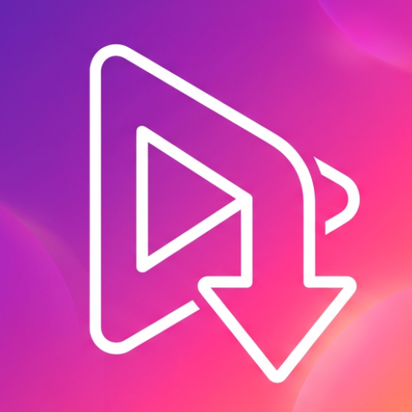

<div align="center">



# Загрузчик

**Скачивание видео с YouTube и ещё 1800+ сайтов прямо на Android.**<br>
Нажал «Поделиться», выбрал качество — видео скачано или уже отправлено в Telegram.

<a href="https://github.com/DomenicoCano/Downloader/releases/latest/download/app-release.apk">
  
</a>

[](#установка)
[](#сборка-из-исходников)
[](https://github.com/yt-dlp/yt-dlp)
[](https://github.com/DomenicoCano/Downloader/releases/latest)

[Возможности](#возможности) • [Установка](#установка) • [Как пользоваться](#как-пользоваться) • [Telegram](#отправка-в-telegram) • [Сборка](#сборка-из-исходников) • [Ограничения](#ограничения)


</div>

## Возможности

- **Через «Поделиться».** В YouTube (или любом другом приложении) жмёшь «Поделиться» и выбираешь «Загрузчик». Ссылка подставляется сама.
- **Три способа получить видео.**
  - Скачать на устройство.
  - Скачать и отправить в Telegram **без ключей API**: видео сохраняется и открывается системное меню «Поделиться».
  - Отправить в Telegram **без сохранения** на телефон: временный файл удаляется сразу после отправки.
- **Очередь и фоновая загрузка.** Добавляй сколько угодно видео подряд. Загрузка идёт в фоне с уведомлением, можно отменить или повторить любое видео.
- **Качество от 144p до 4K** с размером файла. Экран выбора открывается за ~3 секунды, точный список качеств подгружается в фоне.
- **Любая папка для сохранения**, включая SD-карту и USB-флешку.
- **1800+ сайтов:** YouTube, TikTok, Instagram, X/Twitter, Facebook, Reddit, Vimeo, VK, Rutube, Twitch и другие.
- **Удаление после отправки** (по желанию): после возврата из Telegram приложение спросит, удалить ли файл.
- **Автообновление yt-dlp**, чтобы загрузка не ломалась при изменениях на сайтах.
- **Светлая, тёмная и чёрная (OLED) темы**, шрифт Roboto, раздел «Вопросы» с ответами внутри приложения.

## Установка

1. Нажми **Скачать APK** вверху или открой [Releases](https://github.com/DomenicoCano/Downloader/releases).
2. Открой файл на телефоне и разреши установку из этого источника, если Android спросит.
3. Запусти приложение. Первый запуск чуть дольше обычного: готовятся встроенные компоненты.

Требования: Android 10 (API 29) или новее, около 260 МБ свободного места.

> [!NOTE]
> Приложения нет в Google Play, поэтому при установке Android может показать предупреждение. Исходный код открыт: его можно проверить и собрать самому.

## Как пользоваться

1. В YouTube открой видео и нажми **Поделиться → Загрузчик**. Ссылку можно и вставить вручную на главном экране.
2. Выбери качество.
3. Выбери действие: **Скачать на устройство**, **Скачать и отправить в Telegram** или **Отправить в Telegram через API**.
4. Следи за прогрессом на экране **Очередь**. Папка сохранения, удаление после отправки и тема меняются в **⋮ → Настройки**.

### Сохранение на SD-карту или флешку

**⋮ → Настройки → Выбрать папку**. В системном окне открой меню, выбери накопитель и папку, затем «Использовать эту папку». Кнопка «По умолчанию» вернёт `Movies/Downloader`.

## Отправка в Telegram

| Способ | Нужен вход в Telegram | Видео остаётся на телефоне |
|---|---|---|
| Скачать и отправить в Telegram | Нет | Да (можно удалить после отправки) |
| Отправить через API | Да (`api_id` и `api_hash`) | Нет |

Видео в обоих случаях уходит файлом, а не ссылкой.

<details>
<summary>Как получить api_id и api_hash</summary>

1. Открой [my.telegram.org](https://my.telegram.org) и войди по номеру телефона.
2. Выбери **API development tools** и создай приложение (название и короткое имя любые).
3. Введи `api_id` и `api_hash` в приложении, затем номер телефона и код из Telegram.

Ключи и сессия хранятся только на твоём телефоне. Если сайт выдаёт ошибку, попробуй другой браузер или VPN.

</details>

## Сборка из исходников

Нужна последняя Android Studio (или JDK 17+ и Android SDK) и доступ в интернет.

```bash
git clone https://github.com/DomenicoCano/Downloader.git
cd Downloader
./gradlew assembleDebug    # app/build/outputs/apk/debug/
./gradlew installDebug     # сборка и установка на подключённый телефон
```

Релиз собирай и подписывай своим ключом: **Build → Generate Signed App Bundle / APK**.

| Компонент | Назначение |
|---|---|
| [youtubedl-android](https://github.com/yausername/youtubedl-android) | yt-dlp и ffmpeg внутри приложения |
| [TDLib](https://github.com/tdlib/td) + [tdl-coroutines](https://github.com/g000sha256/tdl-coroutines) | отправка видео в Telegram от имени пользователя |
| Jetpack Compose, Material 3 | интерфейс |
| Foreground-сервис | фоновая очередь загрузок |

> [!TIP]
> Архитектура и нюансы сборки (почему отключён R8, версия Kotlin, замеры скорости) описаны в [`CLAUDE.md`](CLAUDE.md).

## Ограничения

> [!IMPORTANT]
> Скачивай только то, что тебе разрешено: свои ролики, видео с открытой лицензией или для личного просмотра в рамках закона и правил сервиса. Ответственность за использование лежит на пользователе.

- Закрытые и приватные видео (нужен вход в аккаунт сайта) не скачиваются.
- Сервисы с защитой DRM (Netflix, Disney+, Кинопоиск и подобные) не поддерживаются.
- Плейлисты и каналы целиком не скачиваются, берётся одно видео.
- Очередь хранится в памяти: если закрыть приложение смахиванием, незавершённые загрузки пропадут.
- Android не сообщает, дошло ли видео при отправке через системное меню, поэтому файл удаляется только после твоего подтверждения.

## Благодарности

[yt-dlp](https://github.com/yt-dlp/yt-dlp), [youtubedl-android](https://github.com/yausername/youtubedl-android), [TDLib](https://github.com/tdlib/td), [tdl-coroutines](https://github.com/g000sha256/tdl-coroutines), [yoinks](https://github.com/pablostanley/yoinks) (идея «вставил ссылку и скачал») и шрифт [Roboto](https://fonts.google.com/specimen/Roboto).
