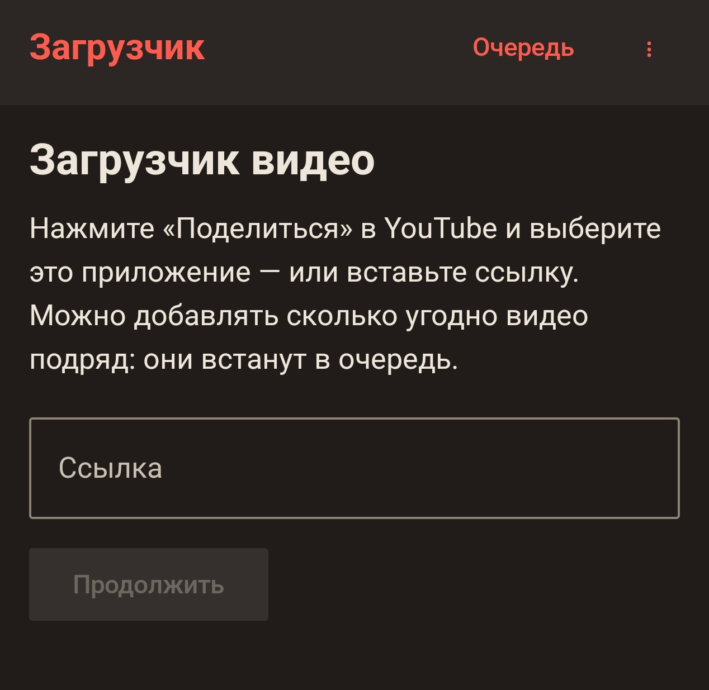

<div align="center">

# 📥 Загрузчик

**Скачивай видео из YouTube и ещё 1800+ сайтов прямо с телефона.**
Нажал «Поделиться» → выбрал качество → видео скачано или уже отправлено в Telegram.

<br>

<a href="https://github.com/DomenicoCano/Downloader/releases/latest/download/app-release.apk">
  
</a>

<sub>Android 10 и новее · ~260 МБ · [все версии](https://github.com/DomenicoCano/Downloader/releases)</sub>

<br><br>



</div>

---

## 🔥 Главные возможности

| | |
|---|---|
| **📤 Через «Поделиться»** | В YouTube (и любом другом приложении) жмёшь «Поделиться» и выбираешь «Загрузчик». Ссылка подставляется сама. Можно и вставить вручную. |
| **✈️ Скачать и отправить в Telegram — без API** | Видео сохраняется на телефон и сразу открывается меню «Поделиться»: выбираешь Telegram и чат. Уходит **файлом, а не ссылкой**. Ключи и вход в аккаунт не нужны. |
| **🕶 Отправка в Telegram без сохранения на телефон** | Видео скачивается во временный кэш, отправляется от твоего аккаунта в любой чат или канал и **сразу удаляется**. Вход через `api_id` и `api_hash`. |
| **📚 Очередь и фоновая загрузка** | Ставь в очередь сколько угодно видео подряд. Загрузка идёт в фоне с уведомлением и прогрессом, приложение можно свернуть. Отмена и повтор для каждого видео. |
| **🎞 Выбор качества до 4K** | От 144p до 2160p, с размером файла. Экран выбора открывается за ~3 секунды, а список качеств уточняется в фоне. |
| **💾 Куда сохранять — решаешь ты** | Память телефона, **SD-карта или USB-флешка**: любая папка через системный выбор. |
| **🌍 1800+ сайтов** | YouTube, TikTok, Instagram, X/Twitter, Facebook, Reddit, Vimeo, VK, Rutube, Twitch и многие другие. |
| **🧹 Удалять после отправки** | Опция: после возврата из Telegram приложение спросит, удалить ли файл с устройства. |
| **🔄 Автообновление yt-dlp** | Движок скачивания сам обновляется, чтобы не ломаться при изменениях YouTube. |
| **🎨 Три темы и стиль «лофт»** | Светлая, тёмная и чёрная для OLED-экранов. Индустриальный лофт, красные акценты YouTube, шрифт Roboto. |
| **❓ Раздел «Вопросы»** | Ответы на частые вопросы прямо в приложении. |

---

## 🚀 Как пользоваться

1. Установи APK (см. ниже).
2. В YouTube открой видео → **Поделиться** → **Загрузчик**.
3. Выбери качество.
4. Выбери действие:
   - **Скачать на устройство**
   - **Скачать и отправить в Telegram** (без API)
   - **Отправить в Telegram через API** (без сохранения)
5. Следи за прогрессом на экране **Очередь**.

## 📲 Установка

1. Нажми **«Скачать APK»** вверху (или открой [Releases](https://github.com/DomenicoCano/Downloader/releases)).
2. Открой скачанный файл на телефоне. Если Android спросит, разреши установку из этого источника.
3. Готово. Первый запуск чуть дольше обычного: приложение готовит встроенные компоненты.

> Приложение не из Google Play, поэтому Android может показать предупреждение при установке. Исходный код открыт, его можно проверить и собрать самому.

## 🔑 Как получить api_id и api_hash (нужны только для отправки без сохранения)

1. Открой [my.telegram.org](https://my.telegram.org) и войди по номеру телефона.
2. Выбери **API development tools** и создай приложение (название и короткое имя любые).
3. Скопируй `api_id` и `api_hash` в приложение. Дальше введи номер телефона и код из Telegram.

Если сайт выдаёт ошибку, попробуй другой браузер или VPN и повтори позже. Ключи хранятся только на твоём телефоне.

## ⚠️ Ограничения

- Закрытые и приватные видео (нужен вход в аккаунт) не скачиваются.
- Сервисы с защитой DRM (Netflix, Disney+, Кинопоиск и подобные) не поддерживаются.
- Плейлисты и каналы целиком не скачиваются, берётся одно видео.
- Очередь хранится в памяти: если закрыть приложение смахиванием, незавершённые загрузки пропадут.
- Android не сообщает приложению, дошло ли видео при отправке через меню «Поделиться», поэтому удаление файла делается по твоему подтверждению.

## 🛠 Сборка из исходников

Нужны Android Studio (или JDK 17+ и Android SDK) и интернет.

```bash
git clone https://github.com/DomenicoCano/Downloader.git
cd Downloader
./gradlew assembleDebug      # APK: app/build/outputs/apk/debug/
./gradlew installDebug       # сразу установить на подключённый телефон
```

Релизную сборку подписывай своим ключом (Build → Generate Signed App Bundle / APK).

Технологии: Kotlin, Jetpack Compose, Material 3, [youtubedl-android](https://github.com/yausername/youtubedl-android) (yt-dlp + ffmpeg), [TDLib](https://github.com/tdlib/td) через [tdl-coroutines](https://github.com/g000sha256/tdl-coroutines), foreground-сервис для очереди.

## 🙏 Благодарности

- [yt-dlp](https://github.com/yt-dlp/yt-dlp): движок скачивания.
- [yoinks](https://github.com/pablostanley/yoinks): идея «вставил ссылку и скачал».
- [youtubedl-android](https://github.com/yausername/youtubedl-android), [TDLib](https://github.com/tdlib/td), [tdl-coroutines](https://github.com/g000sha256/tdl-coroutines).
- Шрифт [Roboto](https://fonts.google.com/specimen/Roboto) (Apache License 2.0).

## ⚖️ Правовое примечание

Скачивай только то, что тебе разрешено: свои ролики, видео с открытой лицензией, либо для личного просмотра в рамках закона и правил сервиса. Ответственность за использование скачанного лежит на пользователе.
